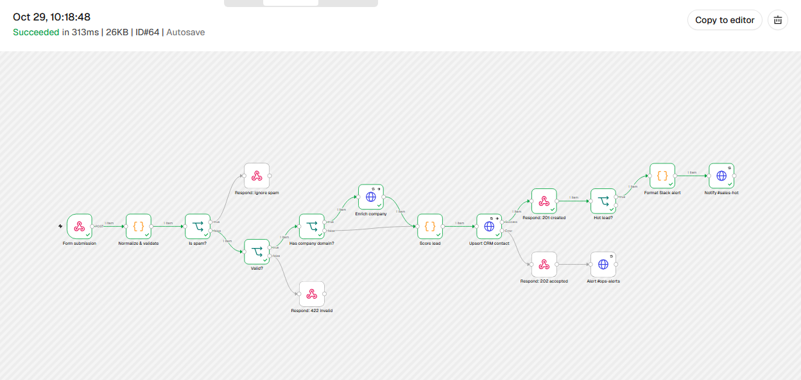
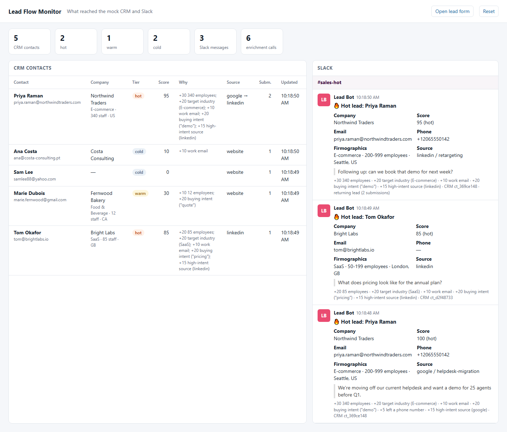
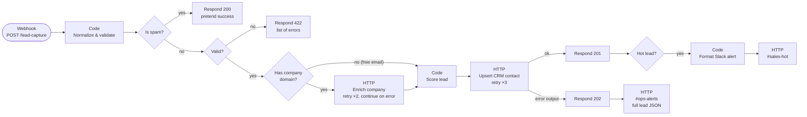
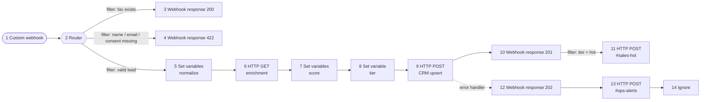

# Lead-Capture Automation Pack

Ready-to-import **n8n** and **Make** workflows that take a website form submission, enrich the company, score the lead, upsert it in a CRM and alert sales in Slack. Mock services are included so the whole flow runs on your machine.

A "contact sales" form usually ends in an inbox. Someone copies the details into the CRM a day later, looks the company up by hand, and the one lead worth calling back the same hour waits with the rest. This pack automates that path. It drops spam silently, rejects bad input with a clear 422, looks the company up by email domain, scores the lead from firmographics and intent, and upserts the contact by email so repeat submissions don't create duplicates. It answers the visitor in 150–300 ms (measured against the mocks) and posts only **hot** leads to `#sales-hot`. If the CRM is down, the visitor still gets a 202, and `#ops-alerts` gets the full lead so it isn't lost.





## The n8n workflow

[n8n/lead-capture.workflow.json](n8n/lead-capture.workflow.json), 16 nodes.



| Step | What it does |
| --- | --- |
| **Normalize & validate** | Trims and collapses whitespace, lowercases the email, splits the name, strips the phone to digits, caps field lengths, reads UTM fields. Rejects bad emails, disposable domains, a missing name or missing consent, and lists every problem at once. A filled-in hidden `fax` field (honeypot) marks the submission as spam. |
| **Has company domain?** | For a work email, uses its domain. For Gmail and other free providers, falls back to the `website` field. With neither, skips the enrichment call, which saves money with paid APIs like Clearbit or Apollo. |
| **Enrich company** | `GET /enrich/v1/companies?domain=` returns name, industry, headcount and location. A 404 or an outage doesn't stop the lead (*continue on error*). Scoring just has less to go on. |
| **Score lead** | 0–100 score with human-readable reasons (see below), plus the CRM body. |
| **Upsert CRM contact** | `POST /crm/v1/contacts`, deduplicated by email. The CRM keeps first-touch `source` and stores `latestSource`, and blank fields don't overwrite stored ones. |
| **Respond** | Every path through the workflow ends in exactly one *Respond to Webhook* node (a test checks this). The visitor is answered before Slack is called, so a slow Slack call never slows down the form. |
| **Format Slack alert** | Block Kit message: company, score, contact details, firmographics, the visitor's message and the CRM id. User input is escaped, so a form that says `<!channel>` can't ping the whole channel. |

### Lead scoring

From [n8n/code/score-lead.js](n8n/code/score-lead.js). The thresholds and lists are constants at the top of the file.

| Signal | Points |
| --- | --- |
| Company size ≥ 200 / 50–199 / 10–49 employees | 30 / 20 / 10 |
| Target industry (SaaS, E-commerce, Fintech) | 20 |
| Work email (not Gmail, Yahoo, …) | 10 |
| Buying intent in the message (`pricing`, `demo`, `quote`, `trial`, `buy`, …) | 20 |
| Left a phone number | 5 |
| High-intent source (`utm_source` google, linkedin, referral, partner) | 15 |
| **Tier** | **hot ≥ 60**, warm ≥ 30, cold < 30 |

The score is saved on the contact with its reasons, for example `+30 340 employees; +20 target industry (E-commerce); +10 work email; +20 buying intent ("demo")`, so sales can see why a lead is hot.

### Failure handling

| What fails | What happens |
| --- | --- |
| Enrichment API (404, 5xx, timeout) | Retried once, then the lead continues without firmographics |
| CRM (5xx, timeout, bad key) | Retried 3× with 1 s between attempts, then the **error output** answers 202 and posts the lead JSON to `#ops-alerts` for manual entry |
| Slack | Retried 3×. The lead is already saved and the visitor already answered, so the execution is marked *failed* in n8n's execution list, where an error workflow can pick it up |
| Spam / invalid input | Answered immediately, and no API is called |

### No secrets in the export

API keys live in n8n **credentials** (*Header Auth*). URLs come from environment variables (`$env.CRM_API_URL`, …). The workflow file holds neither, and a test fails if a key or Slack webhook URL ends up in it. [n8n/demo-credentials.json](n8n/demo-credentials.json) holds the keys for the **mock** services only.

### Code nodes are real files

The JavaScript in the three Code nodes lives in [n8n/code/](n8n/code/), where it can be read, diffed and unit-tested. `npm run sync:n8n` copies it into the workflow JSON, and a test fails if the two drift apart. If you edit a Code node in the n8n editor instead, paste it back into the file.

## The Make scenario

[make/lead-capture.blueprint.json](make/lead-capture.blueprint.json) is the same flow built from Make's own modules.



Where it differs from the n8n version, because of how Make works:

- **Router filters do the validation.** The three routes are mutually exclusive (a test runs every sample lead through the filters). Make has no general code step, so normalizing and scoring are formulas (`lower()`, `split()`, `if()`, `contains()`) in *Set variables* modules.
- **Enrichment runs for every valid lead.** A filter between two Make modules stops the bundle, which would drop free-email leads, so the HTTP call runs with *Evaluate all states as errors* off and a 404 just yields empty fields.
- **Intent words match substrings** (`contains()`), not whole words as in n8n.
- **The CRM error handler** answers 202, alerts `#ops-alerts` and ends with *Ignore*. To have Make retry the CRM later instead, swap *Ignore* for *Break* with automatic retry and turn on *Store incomplete executions*. The visitor still gets their 202 first.
- **Free-text fields are cleaned for JSON.** Double quotes, backslashes and newlines in names and messages are replaced before being put into the raw JSON bodies.

## Tech stack

- **n8n 2.x**: Webhook, Code, IF, HTTP Request (Header Auth credentials, retries, error outputs) and Respond to Webhook nodes
- **Make**: Custom webhook, Router with filters, Set variables, HTTP, Webhook response, error-handler route
- **Node.js 22** with no dependencies: mock enrichment API, CRM, Slack incoming webhooks, demo form, dashboard
- **node:test**: 55 tests that need no n8n, Make account or API keys, plus 2 live tests against a running n8n
- **Docker Compose**: n8n with the workflow and credentials imported on startup, plus the mock services

## Run it

### Docker

```bash
cp .env.example .env          # set N8N_ENCRYPTION_KEY to a random string
docker compose up --build
```

- n8n: http://localhost:5678. Create the owner account on first visit. The workflow is already imported and published.
- Demo form: http://localhost:4000/form
- Dashboard (mock CRM + Slack): http://localhost:4000

Then send the eight sample leads (hot, warm, cold, unknown company, invalid, spam, repeat):

```bash
npm run send-leads
```

### Without Docker

n8n 2.45 needs **Node.js 24 or newer**. The mock services and tests run on Node 22.

```bash
cp .env.example .env
npm run mocks                       # terminal 1: mock services on :4000

# terminal 2: n8n on :5678. n8n doesn't read .env, so export it first.
set -a; . ./.env; set +a
npx n8n@2.45.6 import:credentials --input=n8n/demo-credentials.json
npx n8n@2.45.6 import:workflow --input=n8n/lead-capture.workflow.json
npx n8n@2.45.6 publish:workflow --id=LeadCapture0001
npx n8n@2.45.6 start

npm run send-leads                  # terminal 3
```

On Windows without the Visual C++ build tools, n8n's `isolated-vm` dependency fails to compile. Installing with `npm install n8n@2.45.6 --ignore-scripts` and then running `npm rebuild sqlite3` works, and that is how this workflow was tested.

To make a service fail, run `curl -X POST localhost:4000/_mock/faults -H "content-type: application/json" -d "{\"crm\":1}"` and send a lead. It gets a 202, and the dashboard shows the `#ops-alerts` message. Send `{"crm":0}` to turn it off.

### Make

Make runs in the cloud, so it can't reach `localhost`. Put the mock services behind a tunnel (for example `cloudflared tunnel --url http://localhost:4000`), or use your real services, then:

```bash
ENRICH_API_URL=https://<tunnel> CRM_API_URL=https://<tunnel> \
SLACK_SALES_WEBHOOK_URL=https://<tunnel>/slack/hooks/sales-hot \
SLACK_OPS_WEBHOOK_URL=https://<tunnel>/slack/hooks/ops-alerts \
npm run configure:make
```

This writes `make/lead-capture.blueprint.local.json` (gitignored) with your URLs and keys filled in. In Make, open **Create a new scenario → ⋯ → Import blueprint**, choose that file, add a webhook in module 1, and set the scenario to run *immediately*. Then point the form at it with `MAKE_WEBHOOK_URL=<webhook URL>`, or run `npm run send-leads -- <webhook URL>`.

## Tests

```bash
npm test
```

55 tests in five suites, with no n8n, Make account or API keys needed:

- **n8n-flow**: runs the exported JSON itself (expressions, IF branches, paired items, retries, error outputs) through a small interpreter ([test/helpers/n8n-runner.js](test/helpers/n8n-runner.js)) against the mock services. It covers the sample leads and the failure cases: enrichment down, CRM down, Slack down, a wrong API key, a repeat lead. Code nodes run in a `node:vm` sandbox with the same globals as n8n's task runner (no `URL`, `fetch` or `process`), because the first live run showed that code using `URL` works in plain Node but not in n8n.
- **n8n-code-nodes**: unit tests for the Code nodes, covering normalization edge cases, every scoring rule and tier boundary, and Slack escaping and truncation.
- **n8n-structure**: every node is reachable, every path answers the webhook exactly once, error outputs are wired, `$('Node')` references point upstream, expressions compile, no secrets, credentials match.
- **make-blueprint**: unique ids, every `{{N.field}}` refers to an upstream module, balanced formulas, JSON bodies stay valid, router filters don't overlap, placeholders only.
- **mock-services**: the enrichment, CRM and Slack mocks, fault injection and body limits.

The interpreter is not n8n. To check the same workflow on a real instance, start the stack and run:

```bash
N8N_WEBHOOK_URL=http://localhost:5678/webhook/lead-capture MOCKS_URL=http://localhost:4000 npm run test:e2e
```

Both live tests (all eight sample leads, and a CRM outage → 202 + 3 retries + `#ops-alerts`) pass against n8n 2.45.6. The screenshots above come from that run.

## Using real services

| Mock | Swap for | Change |
| --- | --- | --- |
| `GET /enrich/v1/companies` | Clearbit, Apollo, People Data Labs | URL and query parameter in *Enrich company*. Map their field names at the top of *Score lead* |
| `POST /crm/v1/contacts` | HubSpot, Pipedrive, GoHighLevel | Replace the HTTP node with the n8n CRM node (HubSpot *Create or update contact* upserts by email), or keep the HTTP node and point it at the CRM's upsert endpoint |
| `POST /slack/hooks/:channel` | Slack incoming webhooks | Set `SLACK_SALES_WEBHOOK_URL` / `SLACK_OPS_WEBHOOK_URL` to `https://hooks.slack.com/services/…`. The payload is already Block Kit |

## Project layout

```
n8n/
  lead-capture.workflow.json   the n8n export (import this)
  code/*.js                    source of the three Code nodes
  demo-credentials.json        Header Auth credentials for the mocks
make/
  lead-capture.blueprint.json  the Make export, with placeholders
mock-services/
  server.js                    enrichment, CRM, Slack, fault injection
  companies.json               companies the enrichment mock knows
  public/                      demo form and dashboard
scripts/
  send-sample-leads.js         posts fixtures/sample-leads.json to a webhook
  sync-n8n-code.js             n8n/code → workflow JSON
  configure-make-blueprint.js  fills the Make placeholders
test/                          node:test suites, n8n interpreter, live e2e test
```

## Limitations

- **The Make blueprint hasn't been imported into a live Make account.** It follows Make's export format and the tests check its wiring, but formula syntax and module versions are only checked when you import it. Make may ask you to re-select the webhook and confirm module versions.
- **The n8n tests use an interpreter, not n8n.** It covers the five node types this workflow uses. `npm run test:e2e` checks the same workflow on a real n8n.
- **`$env` access must be allowed.** The workflow reads URLs from environment variables, which n8n blocks unless `N8N_BLOCK_ENV_ACCESS_IN_NODE=false` (set in the compose file and `.env.example`). If you can't change that setting (n8n Cloud), replace the `$env.…` URLs in the four HTTP nodes with literal URLs.
- **A re-import takes up to a minute to go live.** After `import:workflow` and `publish:workflow` on an instance that already had the workflow published, n8n 2.45 kept running the old version for about a minute after restart, until its publication reconciler caught up. A first import isn't affected.
- **Docker Compose wasn't run here.** The machine this was built on has no Docker. The compose file runs the same import → publish → start sequence that was tested with n8n 2.45.6 on Node 24, but the containers themselves are untested.
- **No rate limiting or CAPTCHA on the webhook.** The honeypot stops simple bots only. For a public form, put the webhook behind Cloudflare Turnstile or reCAPTCHA and check the token in *Normalize & validate*.
- **Leads aren't queued when the CRM is down.** `#ops-alerts` gets the full payload for manual entry. A queue or retry schedule would recover them on its own.
- **Scoring is rule-based** and the weights are guesses. Tune them against your own closed-won data.

Relaydesk, the companies and the people in the sample data are made up.

## sort entries

Updated implementation details.

## aggregate stats

Updated implementation details.

## acknowledge receipt

Updated implementation details.

## verify token

Updated implementation details.

## sort entries

Updated implementation details.

## prune old data

Updated implementation details.